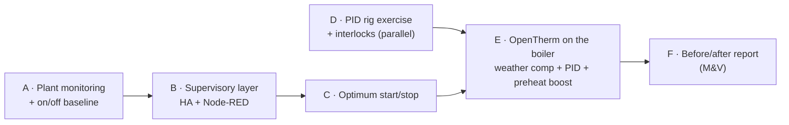

# The Control Cabinet

**Building automation and controls projects, built on real plant and documented to BMS standards: points lists, I/O schedules, commissioning and test records, fault diagnosis and decision logs.** I'm moving into **BMS / building automation engineering** after 25 years delivering business change programmes across financial services, insurance, telecoms and energy, with degrees in **Physics** and **Telecoms Engineering**.

📺 [The Control Cabinet on YouTube](https://www.youtube.com/channel/UC5Cupmz7vlfcodpCX7k8iuQ)

## In brief (one-minute read)

- **Real systems, not just labs.** A two-controller heating system (18 zones, radiators and underfloor, two unvented cylinders) integrated at radio-protocol level; mains water metered over Modbus RTU and field-calibrated; boiler-plant instrumentation on ESP32 controllers, with a designed OpenTherm control stage (weather compensation + PID, fail-safe changeover); fire/CO alarms interfaced through volt-free contacts; and a virtual pinball cabinet with real 24 V coils, layered protection and live current monitoring.
- **Protocols:** Modbus RTU and TCP, BACnet/IP, MQTT, Zigbee, Bluetooth LE, RAMSES-II (868 MHz), OpenTherm (design stage), plus SDR surveying of 433/868 MHz.
- **Engineering method:** every project has a points list or I/O schedule, a test record and an honest issues log. Faults are worked to root cause with evidence; for example, a permanent 5 °C override on both heating controllers was traced through eight tested hypotheses and packet-log analysis.
- **Head-end thinking:** a ~110-integration Home Assistant estate documented as a **BMS integration schedule** (protocol, local vs cloud, read vs write, resilience and command-authority tiers), plus a cyber-security and privacy baseline built on OT principles.

## Qualifications and training

| Qualification / course | Status |
|---|---|
| **BCM01, BCM02, BCM03** (building controls) | ✅ Passed |
| **18th Edition (BS 7671)** wiring regulations | ✅ Passed |
| **City & Guilds Safe Isolation** | ✅ Completed |
| **ECS Health & Safety** + **ECS BMS installer card** | ✅ Held |
| **Resideo heating controls wiring** (S-plan and Y-plan wiring, Evohome, TPI) | ✅ Completed Oct 2026 |
| Smart Buildings Academy: BAS Operator, BAS Installer, HVAC 101, BAS Fundamentals | ✅ Completed |
| Udemy: three BMS fundamentals courses | ✅ Completed |
| efixx / Crompton Controls: BMS control panels; 3-phase introduction | ✅ Completed |
| Manufacturer e-learning: Tridium Niagara, KNX eCampus/ETS, Siemens TIA Portal/PLCSIM, Schneider Electric University, CODESYS | 🚧 In progress |

## Start here

| If you have five minutes | Why |
|---|---|
| [Evohome heating controls & RAMSES-II integration](https://github.com/the-control-cabinet/evohome-heating-controls-ramses-integration) | Real HVAC controls, protocol-level integration, a full fault case study |
| [Heating plant monitoring](https://github.com/the-control-cabinet/heating-plant-monitoring-esphome) | Plant-room points list, signal conditioning, boiler state detection; the measurement layer for the OpenTherm control design |
| [Mains water metering – Modbus RTU](https://github.com/the-control-cabinet/mains-water-metering-modbus-rtu) | Modbus RTU field device, calibration against measured volumes, metering dashboards |

## Heating controls: delivery sequence

The heating work is delivered as a staged programme, like a BMS upgrade: **measure first**, then build the supervisory layer and its first function, then change the plant control, with each step measured against the last.

| Step | Project | Status |
|---|---|---|
| A | [Heating plant monitoring](https://github.com/the-control-cabinet/heating-plant-monitoring-esphome) | 🚧 In progress |
| B | [HA + Node-RED supervisory layer](https://github.com/the-control-cabinet/ha-node-red-supervisory-layer) | 🚧 In progress (design) |
| C | [Multi-zone optimum start/stop](https://github.com/the-control-cabinet/optimum-start-stop-supervisory) | 📐 Design stage |
| D | [PID with anti-hunt: rig exercise](https://github.com/the-control-cabinet/pid-anti-hunt-control-rig) | 📐 Design stage |
| E | [OpenTherm boiler control](https://github.com/the-control-cabinet/opentherm-boiler-control-esphome) | 📐 Design stage |
| F | [Energy dashboard: before/after report](https://github.com/the-control-cabinet/home-energy-dashboard) | 📐 Planned |

## Skills matrix: BMS competencies mapped to evidence

| Competency | Where it's shown |
|---|---|
| **Points lists / I/O schedules** | [Plant monitoring](https://github.com/the-control-cabinet/heating-plant-monitoring-esphome) · [Water metering](https://github.com/the-control-cabinet/mains-water-metering-modbus-rtu) · [Aico interface](https://github.com/the-control-cabinet/aico-ei413-shelly-ha) · [VPin](https://github.com/the-control-cabinet/tukkari-vpin-real-mech-cabinet) · [Aircon DP map](https://github.com/the-control-cabinet/localtuya-portable-aircon-dp-map) |
| **Modbus (RTU / TCP)** | [Water metering](https://github.com/the-control-cabinet/mains-water-metering-modbus-rtu) · [Modbus TCP collector](https://github.com/the-control-cabinet/modbus-tcp-data-collector) · [Modbus server](https://github.com/the-control-cabinet/esp32-modbus-server-plant-points) |
| **BACnet/IP** | [BACnet/IP explorer](https://github.com/the-control-cabinet/bacnet-ip-network-explorer) · [Plant points BACnet server](https://github.com/the-control-cabinet/plant-points-bacnet-server) |
| **Vendor DDC (Trend)** | [Trend IQ411 commissioning](https://github.com/the-control-cabinet/trend-iq411-commissioning) |
| **PLC programming (IEC 61131-3)** | [PLC re-implementation](https://github.com/the-control-cabinet/plc-reimplementation-iec61131) · [three-platform comparison](https://github.com/the-control-cabinet/plc-reimplementation-iec61131/blob/main/docs/03-three-platform-comparison.md) |
| **HVAC controls** | [Evohome](https://github.com/the-control-cabinet/evohome-heating-controls-ramses-integration) · [Plant monitoring](https://github.com/the-control-cabinet/heating-plant-monitoring-esphome) · [OpenTherm control](https://github.com/the-control-cabinet/opentherm-boiler-control-esphome) · [Air quality / DCV](https://github.com/the-control-cabinet/indoor-air-quality-monitoring) |
| **Control strategy (PID, weather compensation, interlocks)** | [OpenTherm control](https://github.com/the-control-cabinet/opentherm-boiler-control-esphome) · [PID rig exercise](https://github.com/the-control-cabinet/pid-anti-hunt-control-rig) |
| **Supervisory control and scheduling** | [Supervisory layer](https://github.com/the-control-cabinet/ha-node-red-supervisory-layer) · [Optimum start/stop](https://github.com/the-control-cabinet/optimum-start-stop-supervisory) |
| **Measurement and verification (M&V)** | [Energy dashboard](https://github.com/the-control-cabinet/home-energy-dashboard) · [Optimum start/stop](https://github.com/the-control-cabinet/optimum-start-stop-supervisory) · [OpenTherm control](https://github.com/the-control-cabinet/opentherm-boiler-control-esphome) |
| **Commissioning and test records** | Every project: test tables, calibration runs, transmit audits · plans: [OpenTherm 12-test plan](https://github.com/the-control-cabinet/opentherm-boiler-control-esphome) · [BLE receiver calibration](https://github.com/the-control-cabinet/esp32-ble-presence-network) |
| **Fault diagnosis** | [5 °C override case study](https://github.com/the-control-cabinet/evohome-heating-controls-ramses-integration) · [Water meter calibration](https://github.com/the-control-cabinet/mains-water-metering-modbus-rtu) · [Zigbee availability noise](https://github.com/the-control-cabinet/zigbee-network-migration-z2m) · [ESPHome watchdog resets](https://github.com/the-control-cabinet/esp32-ble-presence-network) |
| **Plant sequences and interlocks** | [Duty/standby + interlocks](https://github.com/the-control-cabinet/din-rail-rig-duty-standby-interlocks) · [Sequence of operation](https://github.com/the-control-cabinet/heating-sequence-of-operation) |
| **Alarm management** | [Alarm and trend strategy](https://github.com/the-control-cabinet/alarm-and-trend-strategy) |
| **Fault detection and diagnostics** | [FDD rules](https://github.com/the-control-cabinet/fdd-rules-heating-plant) |
| **Semantic data (Haystack / Brick)** | [Semantic tagging](https://github.com/the-control-cabinet/haystack-semantic-tagging) |
| **Graphics / HMI** | [Plant-room graphics](https://github.com/the-control-cabinet/plant-room-graphics-hmi) |
| **Documentation and handover (O&M)** | [O&M handover pack](https://github.com/the-control-cabinet/om-manual-handover-pack) · [Sequence of operation](https://github.com/the-control-cabinet/heating-sequence-of-operation) |
| **Standards and change control** | [ESPHome fleet standards](https://github.com/the-control-cabinet/esphome-fleet-standards) |
| **Lighting and shading control** | [Lighting and shading](https://github.com/the-control-cabinet/lighting-and-shading-control) |
| **Energy management and demand response** | [Demand-side energy management](https://github.com/the-control-cabinet/demand-side-energy-management) · [Energy dashboard](https://github.com/the-control-cabinet/home-energy-dashboard) |
| **System health and resilience** | [Head-end health](https://github.com/the-control-cabinet/head-end-health-monitoring) · [ESPHome fleet standards](https://github.com/the-control-cabinet/esphome-fleet-standards) |
| **Life-safety interfaces** | [Fire/CO interface](https://github.com/the-control-cabinet/aico-ei413-shelly-ha) · [Layered leak detection](https://github.com/the-control-cabinet/layered-leak-detection) |
| **Metering and energy** | [Water metering](https://github.com/the-control-cabinet/mains-water-metering-modbus-rtu) · [Energy dashboard](https://github.com/the-control-cabinet/home-energy-dashboard) |
| **Signal conditioning and field wiring** | [Plant monitoring](https://github.com/the-control-cabinet/heating-plant-monitoring-esphome) · [VPin power and protection](https://github.com/the-control-cabinet/tukkari-vpin-real-mech-cabinet) |
| **Wireless field networks and RF** | [Zigbee](https://github.com/the-control-cabinet/zigbee-network-migration-z2m) · [BLE presence](https://github.com/the-control-cabinet/esp32-ble-presence-network) · [RTL-SDR survey](https://github.com/the-control-cabinet/rtl-sdr-rf-exploration) |
| **Head-end / integration management** | [HA integration schedule](https://github.com/the-control-cabinet/home-assistant-integration-schedule) · [Supervisory layer](https://github.com/the-control-cabinet/ha-node-red-supervisory-layer) · [Areas, dashboards and automations](https://github.com/the-control-cabinet/ha-areas-dashboards-automations) |
| **OT cyber security** | [Security baseline](https://github.com/the-control-cabinet/smart-home-security-baseline) |

## Portfolio: top down

### Management level
| Project | Status |
|---|---|
| [Home Assistant integration schedule (~110 integrations, head-end documentation)](https://github.com/the-control-cabinet/home-assistant-integration-schedule) | ✅ Live |
| [Smart-home cyber-security & privacy baseline (OT principles)](https://github.com/the-control-cabinet/smart-home-security-baseline) | ✅ Live |
| [Whole-home energy & utility metering dashboard](https://github.com/the-control-cabinet/home-energy-dashboard) | 📐 Planned |
| [HA + Node-RED supervisory layer](https://github.com/the-control-cabinet/ha-node-red-supervisory-layer) | 🚧 In progress (design) |
| [Alarm and trend strategy (living document)](https://github.com/the-control-cabinet/alarm-and-trend-strategy) | 📐 Living document |
| [Semantic tagging of points (Project Haystack / Brick)](https://github.com/the-control-cabinet/haystack-semantic-tagging) | 📐 Design stage |
| [Fault detection and diagnostics (FDD) rules](https://github.com/the-control-cabinet/fdd-rules-heating-plant) | 📐 Design stage |
| [Plant-room graphics (BMS-style HMI)](https://github.com/the-control-cabinet/plant-room-graphics-hmi) | 📐 Design stage |
| [Sequence of operation: heating and DHW (as-is / to-be)](https://github.com/the-control-cabinet/heating-sequence-of-operation) | 📐 Design stage |
| [O&M manual / handover pack](https://github.com/the-control-cabinet/om-manual-handover-pack) | 📐 Design stage |
| [HA areas, dashboards and automations (occupant layer)](https://github.com/the-control-cabinet/ha-areas-dashboards-automations) | 📐 Design stage |
| [Demand-side energy management (tariff, carbon, peak limiting)](https://github.com/the-control-cabinet/demand-side-energy-management) | 📐 Design stage |
| [Head-end health and availability monitoring](https://github.com/the-control-cabinet/head-end-health-monitoring) | 📐 Design stage |
| Niagara / Tridium familiarisation | Planned |

### Automation level
| Project | Status |
|---|---|
| [Indoor air quality monitoring + demand-controlled ventilation](https://github.com/the-control-cabinet/indoor-air-quality-monitoring) | 🚧 In progress |
| [Layered leak detection](https://github.com/the-control-cabinet/layered-leak-detection) | 🚧 Partly live |
| [AI vision automations (vision as a sensor)](https://github.com/the-control-cabinet/ai-vision-automations) | ✅ Live (local detection planned) |
| [Fault diagnosis case study – Evohome permanent 5 °C override](https://github.com/the-control-cabinet/evohome-heating-controls-ramses-integration#4-part-c--fault-case-study-the-permanent-5-c-override) | ✅ Complete |
| [Tukkari VPin – real-mech cabinet (power, protection, I/O, instrumentation)](https://github.com/the-control-cabinet/tukkari-vpin-real-mech-cabinet) | ✅ Running |
| [Multi-zone optimum start/stop (supervisory, over Evohome/RAMSES-II)](https://github.com/the-control-cabinet/optimum-start-stop-supervisory) | 📐 Design stage |
| [DIN-rail rig: duty/standby pump rotation + interlocks (#7/#9)](https://github.com/the-control-cabinet/din-rail-rig-duty-standby-interlocks) | 🚧 In progress |
| [ESPHome fleet standards (13 controllers)](https://github.com/the-control-cabinet/esphome-fleet-standards) | ✅ Live (documenting) |
| [PID loop with anti-hunt (DIN-rail rig exercise)](https://github.com/the-control-cabinet/pid-anti-hunt-control-rig) | 📐 Design stage |
| [OpenTherm boiler control – weather comp + PID, alongside two Evohome controllers](https://github.com/the-control-cabinet/opentherm-boiler-control-esphome) | 📐 Design stage |
| [Trend IQ411 commissioning](https://github.com/the-control-cabinet/trend-iq411-commissioning) | 📐 Planned |
| [Lighting and solar-shading control](https://github.com/the-control-cabinet/lighting-and-shading-control) | 📐 Design stage |
| [PLC re-implementation – all four IEC 61131-3 languages (#13)](https://github.com/the-control-cabinet/plc-reimplementation-iec61131) | 📐 Design stage |

### Field level
| Project | Status |
|---|---|
| [Evohome heating controls & HA integration (cloud → RAMSES-II, incl. fault case study)](https://github.com/the-control-cabinet/evohome-heating-controls-ramses-integration) | ✅ Complete |
| [Heating plant monitoring – boiler, cylinders, safety devices (ESPHome)](https://github.com/the-control-cabinet/heating-plant-monitoring-esphome) | 🚧 In progress |
| [Mains water metering – Modbus RTU](https://github.com/the-control-cabinet/mains-water-metering-modbus-rtu) | ✅ Complete |
| [Modbus TCP data collector](https://github.com/the-control-cabinet/modbus-tcp-data-collector) | ✅ Complete |
| [BACnet/IP network explorer](https://github.com/the-control-cabinet/bacnet-ip-network-explorer) | ✅ Complete |
| [Fire & CO alarm interface – Aico Ei413 → Shelly → HA](https://github.com/the-control-cabinet/aico-ei413-shelly-ha) | ✅ Complete |
| [Portable aircon – Tuya data-point map, local control](https://github.com/the-control-cabinet/localtuya-portable-aircon-dp-map) | ✅ Complete |
| [Zigbee network migration – ZHA → Zigbee2MQTT (93 devices)](https://github.com/the-control-cabinet/zigbee-network-migration-z2m) | ✅ Complete |
| [ESP32 BLE presence network](https://github.com/the-control-cabinet/esp32-ble-presence-network) | ✅ Live |
| [RTL-SDR RF survey – 433/868 MHz](https://github.com/the-control-cabinet/rtl-sdr-rf-exploration) | ✅ Exploratory |
| [Plant points as a BACnet/IP device](https://github.com/the-control-cabinet/plant-points-bacnet-server) | 📐 Design stage |
| [ESP32 as a Modbus server (plant points to controllers)](https://github.com/the-control-cabinet/esp32-modbus-server-plant-points) | 📐 Design stage |

## Future projects (planned, no repo yet)

Gaps identified in a portfolio review, to be started once more of the design-stage projects have results:

| Project | Gap it closes |
|---|---|
| **Mini air-handling unit on the rig:** duct, PWM fan, damper actuator, heater, temperature/humidity, differential-pressure proving; AHU sequence with frost protection and supply-air PID | Hands-on **air-side HVAC** |
| **Field devices and signals bench:** 0-10 V damper actuator, 4-20 mA transmitter, PT1000, loop calibrator, wired into the Trend IQ411 | Standard **BMS field signals** and point-to-point commissioning |
| **Commissioning sheet set:** point-to-point, functional and witness sheets applied to the rig and the plant install | **Commissioning** documentation |
| **Electrical drawings for the rig:** panel schematics, terminal and cable schedules (QElectroTech) | **Drawings** |
| **RAMS:** risk assessments and method statements for the OpenTherm connection and the plant-monitoring install | **Site safety** documentation |
| **BACnet MS/TP:** RS485 field device discovered and read via YABE | **MS/TP** in practice |
| **M-Bus metering:** USB M-Bus master with a heat/water meter | **Heat-network** metering |
| **Heat-pump readiness study:** heat loss from gas data and degree-days, emitter output at low flow temperatures, DHW strategy, control changes | **Low-carbon heat** |
| **Niagara and KNX write-ups:** a short build note per completed manufacturer module | Vendor **platforms** |
| **Water sub-metering by event detection** (shower, washing machine) | Metering analytics |
| **Weather-responsive alerts and plant actions** | External conditions |
